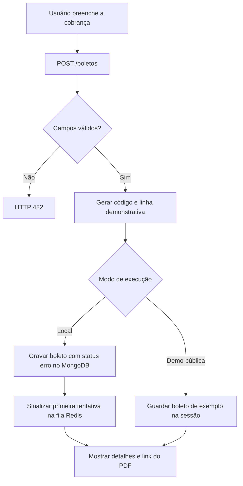
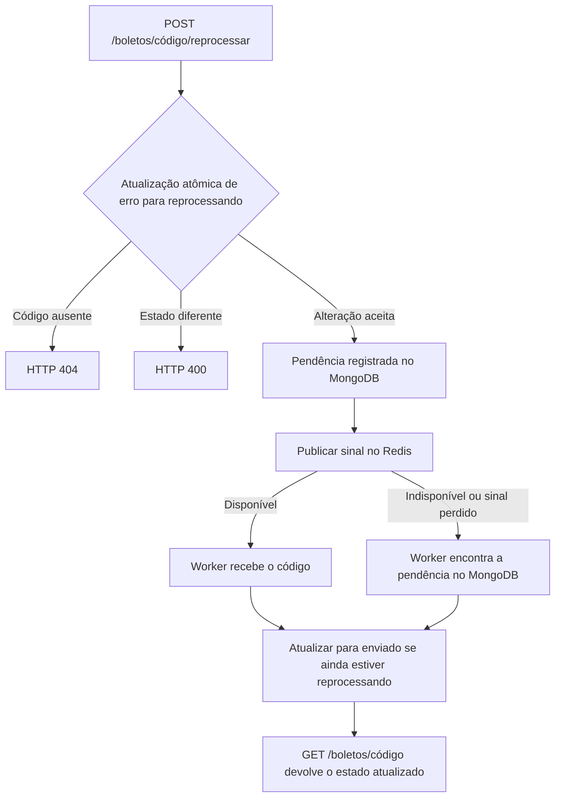

# Boleto Service

Painel web e API para emitir, consultar e reprocessar boletos **simulados**. A emissão cria uma cobrança de exemplo com falha no primeiro envio. Pelo painel, é possível consultar a cobrança pelo código, baixar o PDF e acompanhar o reprocessamento até o status final.

[](https://render.com/deploy?repo=https://github.com/DandaraEmiliano/boleto-service)

## Como testar

1. Selecione **Preencher exemplo** e depois **Emitir boleto simulado**.
2. No painel de detalhes, use **Baixar PDF** ou copie o código para consultar a cobrança.
3. Selecione **Reprocessar**. O estado passa de **Com erro** para **Reprocessando** e depois para **Enviado**.

O PDF e a linha demonstrativa são marcados como simulação. O projeto usa **FastAPI**, **Python 3.11**, **MongoDB**, **Redis** e uma interface responsiva em HTML, CSS e JavaScript.

## Arquitetura

O FastAPI serve a interface e a API na mesma origem. No modo local, o MongoDB é a fonte de verdade do estado dos boletos. O Redis publica sinais com o código da cobrança para os workers. Na demo hospedada, a API mantém a mesma interface e simula as transições em memória, com registros isolados por cookie de sessão e pagadores fictícios predefinidos.

### Fluxograma de emissão



A primeira tentativa falha de propósito para que o reprocessamento possa ser testado. O worker de emissão registra essa tentativa simulada. O PDF é gerado sob demanda a partir dos dados retornados pela consulta.

### Fluxograma de reprocessamento local



### Decisões e limites

- **Concorrência.** A condição da atualização no MongoDB permite apenas uma transição de `erro` para `reprocessando`. A conclusão usa outra atualização condicional. Um sinal duplicado ou atrasado vira uma operação sem efeito.
- **Recuperação.** O estado pendente é a própria intenção de trabalho durável. Se a publicação falhar ou o worker parar após consumir o sinal, o processo recupera a pendência pela consulta ao MongoDB. O Redis carrega somente o código.
- **Compatibilidade.** Os cinco endpoints de boletos continuam disponíveis. As consultas aceitam os códigos numéricos legados. A emissão usa identificadores UUID, e a resposta inclui o status.
- **Demo.** O serviço público usa uma instância gratuita do Render. Boletos ficam na memória da instância, com limite de 2.000 registros e isolamento por sessão. Um reinício apaga as cobranças. O [primeiro acesso após inatividade](https://render.com/docs/free#spinning-down-on-idle) pode levar cerca de um minuto.
- **Escopo da simulação.** A transição para `enviado` representa uma entrega simulada. O modo local foi projetado para uso em loopback com dados de teste. Uma integração bancária exigiria credenciais, autenticação para os operadores e idempotência acordada com o provedor.

## Rodar localmente

### Interface, API, MongoDB, Redis e workers

```bash
docker compose up --build
```

Abra [http://localhost:8000](http://localhost:8000). O contrato OpenAPI fica em [`/docs`](http://localhost:8000/docs).

### Demo sem serviços externos

```bash
python3.11 -m venv .venv
source .venv/bin/activate
pip install -r requirements.txt
BOLETO_DEMO=1 uvicorn app.main:app --reload
```

O Blueprint `render.yaml` configura Docker, `/health`, o modo demo e o cookie `Secure`. O contêiner usa a porta definida por `PORT`.

## Endpoints

| Método | Rota | Operação |
| --- | --- | --- |
| POST | `/boletos` | Emite um boleto simulado |
| GET | `/boletos/{codigo}` | Consulta a cobrança e seu status |
| GET | `/boletos/{codigo}/pdf` | Baixa o PDF demonstrativo |
| GET | `/boletos/status/erro` | Lista boletos com falha |
| POST | `/boletos/{codigo}/reprocessar` | Solicita reprocessamento |
| GET | `/health` | Verifica se o processo HTTP responde |

## Testes

```bash
docker compose up -d --wait mongodb redis
python -m pytest
```

Os testes cobrem o ciclo de vida da demo, isolamento das sessões, PDF, valores inválidos, solicitações concorrentes e recuperação de uma pendência após falha no Redis. O GitHub Actions executa a suíte com MongoDB e Redis.

## Autora

**Dandara Emiliano**  
[GitHub](https://github.com/DandaraEmiliano) · [LinkedIn](https://linkedin.com/in/dandaraemiliano)
