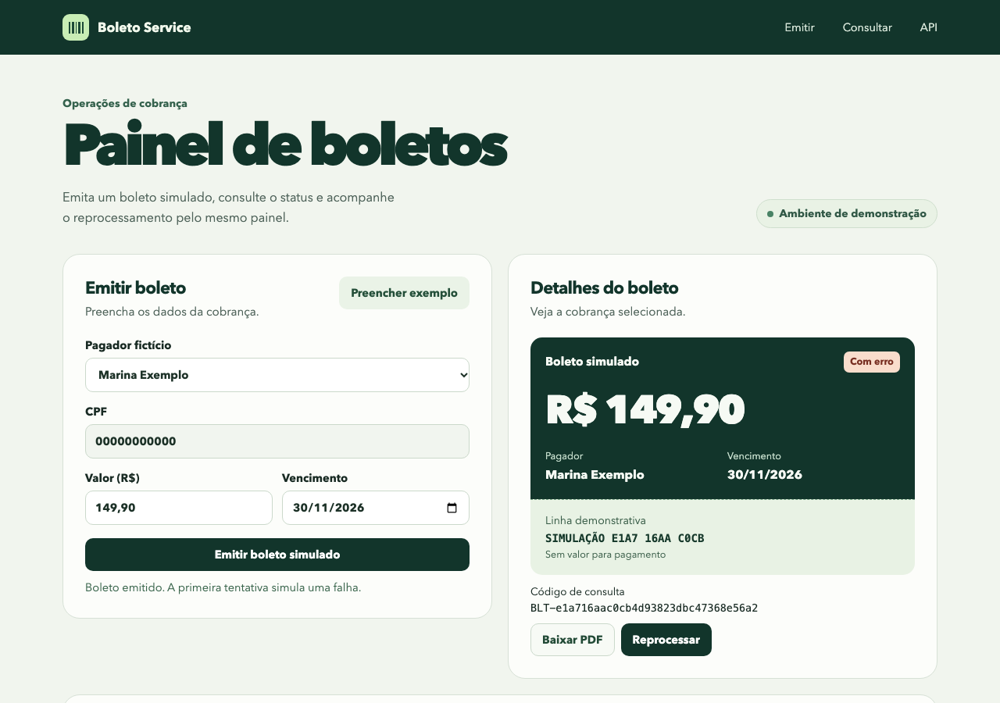
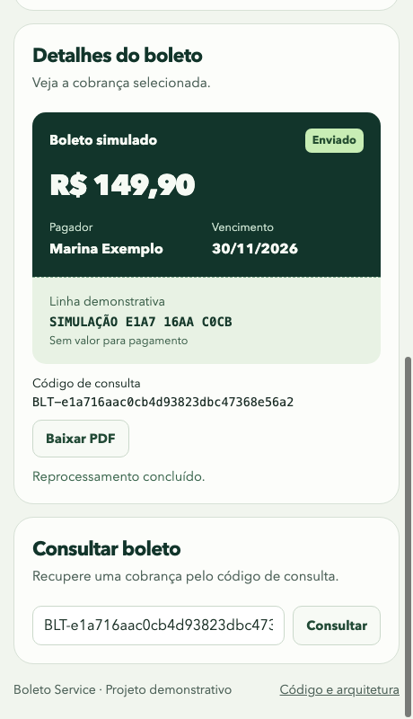
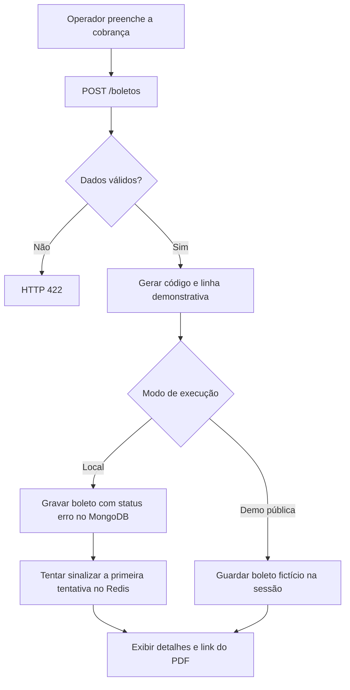
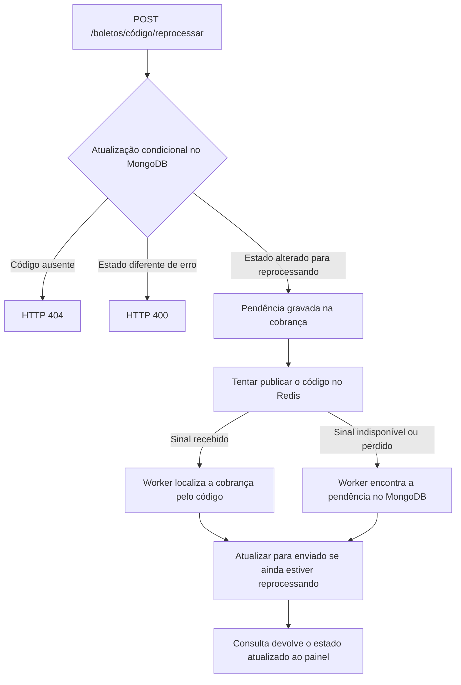

# Boleto Service

Painel web e API para emitir, consultar e reprocessar boletos simulados. O fluxo começa com uma falha de envio intencional para demonstrar como a aplicação registra a pendência, recupera o trabalho e mostra o estado final ao operador.

[**Testar a demo online**](https://boleto-service.onrender.com/) · [Documentação da API](https://boleto-service.onrender.com/docs)

[](https://render.com/deploy?repo=https://github.com/DandaraEmiliano/boleto-service)



## Experimente

1. Clique em **Preencher exemplo** e depois em **Emitir boleto simulado**. O painel exibe a cobrança de R$ 149,90 com o status **Com erro**.
2. Clique em **Baixar PDF** para obter o documento demonstrativo.
3. Clique em **Reprocessar**. O painel acompanha a transição de **Reprocessando** para **Enviado**.
4. Use o **Código de consulta** para recuperar o boleto e conferir o status final.

O PDF e a linha demonstrativa são marcados como simulação. Na demo pública, o código pode ser consultado na mesma sessão que fez a emissão.



## Como funciona

O FastAPI serve a interface em HTML, CSS e JavaScript e a API na mesma origem. O MongoDB persiste o estado das cobranças no modo local. O Redis leva os códigos aos workers. As mensagens contêm apenas o código da cobrança.

| Componente | Responsabilidade |
| --- | --- |
| Painel web | Emissão, consulta, download do PDF e atualização periódica durante o reprocessamento |
| API FastAPI | Validação dos dados, emissão, consulta e isolamento por sessão na demo |
| MongoDB | Persistência, atualizações condicionais de estado e pendências recuperáveis no ambiente local |
| Redis e workers | Sinalização da emissão e execução do reprocessamento local |
| ReportLab | Geração do PDF sob demanda a partir do boleto consultado |

### Fluxograma de emissão



A API valida o valor com até duas casas decimais e gera um código UUID para novas cobranças. A primeira falha é simulada no momento da emissão. No modo local, o worker registra a tentativa quando recebe o sinal. Os códigos numéricos legados continuam aceitos na consulta.

### Fluxograma de reprocessamento local



**Concorrência.** O filtro da primeira atualização permite que apenas uma solicitação altere o estado de `erro` para `reprocessando`. O worker também condiciona a conclusão ao estado atual. Uma mensagem duplicada ou atrasada não reaplica a transição.

**Recuperação.** A pendência é registrada no mesmo documento que descreve a cobrança, antes da tentativa de publicação no Redis. Se o sinal for perdido ou se um worker parar depois de recebê-lo, a próxima varredura encontra o boleto que ainda está em `reprocessando`.

**Integração.** A conclusão representa um envio simulado. Uma integração bancária acrescentaria um contrato de idempotência com o provedor e uma forma de reconciliar tentativas com resposta incerta.

## Demo no Render

O Blueprint cria um serviço web gratuito com Docker, com verificação de processo em `GET /health` e TLS na URL pública. A API aceita uma lista de pagadores fictícios e associa cada boleto a uma sessão por cookie `Secure`, `HttpOnly` e `SameSite=Strict`. A demonstração mantém até 2.000 registros em memória e simula a conclusão após um breve intervalo em consultas de status.

As cobranças são descartadas no reinício da instância. O [primeiro acesso após inatividade](https://render.com/docs/free#spinning-down-on-idle) pode levar cerca de um minuto.

## Rode localmente

```bash
docker compose up --build
```

Abra [http://localhost:8000](http://localhost:8000). O Compose sobe a aplicação, os dois workers, MongoDB e Redis. Os serviços expostos ficam em loopback. Os workers registram eventos pelo código da cobrança.

```bash
docker compose logs -f emissao reprocessamento
```

Para rodar apenas a demo, use Python 3.11.

```bash
python3.11 -m venv .venv
source .venv/bin/activate
pip install -r requirements.txt
BOLETO_DEMO=1 uvicorn app.main:app --reload
```

## Contrato HTTP

| Método | Rota | Operação |
| --- | --- | --- |
| POST | `/boletos` | Emite um boleto simulado |
| GET | `/boletos/{codigo}` | Consulta a cobrança e seu status |
| GET | `/boletos/{codigo}/pdf` | Baixa o PDF demonstrativo |
| GET | `/boletos/status/erro` | Lista cobranças com falha |
| POST | `/boletos/{codigo}/reprocessar` | Solicita reprocessamento |
| GET | `/health` | Verifica se o processo HTTP responde |

## Testes

Com o ambiente Python preparado conforme a seção anterior, suba as dependências e execute a suíte.

```bash
docker compose up -d --wait mongodb redis
python -m pytest
```

O CI executa os testes com MongoDB e Redis. A suíte cobre emissão, PDF, isolamento de sessões, validação de valores, compatibilidade com códigos legados, concorrência no reprocessamento e recuperação de pendências quando a publicação falha. Execute apenas `python -m pytest tests/test_demo.py` para verificar o modo público sem serviços externos.
